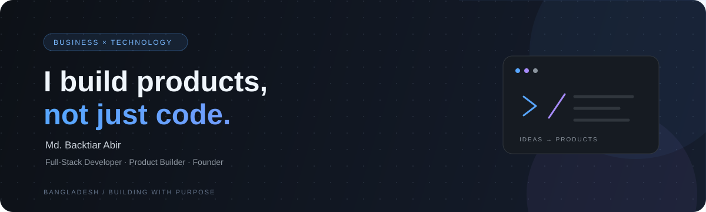

<!--
  Md. Backtiar Abir — GitHub Profile README
  Visual identity: Midnight / Electric Blue / Soft Violet
-->

  

   

  
  
  

    

  <h1>Hi, I'm Md. Backtiar Abir.</h1>

  <h3>Business-Minded Technologist · Full-Stack Developer · Product Builder</h3>

  

    I understand business problems, think like a product builder, 
    and build solutions through technology.
  

   

  

---

## 01 / The Intersection

I'm a Computer Science & Engineering graduate from **Varendra University, Bangladesh**, with a strong interest in entrepreneurship, product development, and software engineering.

What makes my approach different is the combination of business understanding and technical execution.

<table>
  <tr>
    <td width="33%" valign="top">
      <h3>◈ Business</h3>
      
Understanding markets, customer problems, business models, and opportunities.

      Research · Strategy · Entrepreneurship · Growth
    </td>
    <td width="33%" valign="top">
      <h3>⌘ Technology</h3>
      
Turning ideas into functional applications through software engineering.

      Development · APIs · Databases · Architecture
    </td>
    <td width="33%" valign="top">
      <h3>✳ Product</h3>
      
Connecting user needs, product decisions, design thinking, and execution.

      Problem-solving · MVPs · UX thinking · Iteration
    </td>
  </tr>
</table>

I enjoy working across the entire journey — from identifying a problem and researching an opportunity to designing a solution and building the software behind it.

## 02 / What I Work With

### Development

  

### Areas of Interest

- Full-stack application development
- REST API design and backend development
- Relational and NoSQL database design
- Authentication and application security
- Product development and MVP execution
- Business-oriented software solutions

### Currently Exploring

  
  
  
  
  

## 03 / Selected Work

I prefer building products around real problems rather than coding isolated demonstrations.

### 01 — Dockie

**A Peer-to-Peer Printing Marketplace**

A printing marketplace concept designed to connect students with local printing service providers.

<table>
  <tr>
    <td width="65%" valign="top">
      
<b>The product idea</b>

      Make printing more accessible by connecting students, printing providers, and the workflows between them.
        
      <b>Technical work</b>
      <ul>
        <li>Student, printer, and admin modules</li>
        <li>Authentication and authorization</li>
        <li>File upload and printing-order workflows</li>
        <li>MySQL relational database schema</li>
        <li>REST API development and Postman collection</li>
      </ul>
      <b>Stack</b> 
      HTML · CSS · JavaScript · Node.js · Express.js · MySQL · JWT
        
      
    </td>
    <td width="35%" valign="middle" align="center">
      
        
      SOFTWARE + BUSINESS DOCUMENTATION
    </td>
  </tr>
</table>

Dockie also includes supporting business work such as branding, competitor analysis, marketing planning, financial tracking, and valuation documentation.

### 02 — Messo

**A Student Accommodation Platform**

A student-focused platform designed to make finding and managing mess accommodation easier in Bangladesh.

<table>
  <tr>
    <td width="65%" valign="top">
      
<b>The product idea</b>

      Improve the student accommodation discovery experience through a more organized digital platform.
        
      <b>Product areas</b>
      <ul>
        <li>Accommodation discovery</li>
        <li>Room and user management</li>
        <li>Digital booking and payment workflows as product goals</li>
        <li>Student-focused services</li>
      </ul>
      <b>Public repository stack</b> 
      PHP · MySQL · HTML · CSS · JavaScript
        
      
    </td>
    <td width="35%" valign="middle" align="center">
      
        
      STUDENT HOUSING TECHNOLOGY
    </td>
  </tr>
</table>

**Entrepreneurial milestones**

- Winner — UIHP Cohort 3.
- Received a BDT 55,000 pre-seed grant.
- Signed three MoUs and worked on mess-owner partnerships.

These experiences helped me understand that building a product involves much more than writing code.

## 04 / Business & Product Perspective

Beyond development, I enjoy exploring the decisions that shape a product.

| Area | What I explore |
|---|---|
| Business | Business models, market research, competitor analysis |
| Strategy | Product positioning, opportunities, growth planning |
| Product | Requirements, user journeys, MVP planning |
| Execution | Development, iteration, documentation |
| Entrepreneurship | Startup ideation and validation |

I have also explored **Ghorer Khabar**, a homemade food marketplace concept, as part of my interest in marketplace business models.

## 05 / Learning & Growth

Technology changes constantly, and I enjoy learning by building.

My current learning interests include:

- AI and Machine Learning
- Large Language Models
- Retrieval-Augmented Generation
- Vector databases
- AI-powered product development
- Better software architecture and engineering practices

I aim to connect these technologies with useful products and practical problems.

## 06 / Beyond the Code

I am interested in opportunities where engineering meets product thinking.

I would love to collaborate with:

- Product-focused engineering teams
- Early-stage technology startups
- Remote-first companies
- Builders working on meaningful digital products

**Roles I'm interested in:** Full-Stack Developer · Software Engineer · Product Engineer · Startup Engineering

## 07 / Let's Connect

  <h3>Have an interesting problem to solve?</h3>

  I'm always interested in thoughtful conversations, meaningful collaborations, and opportunities to build useful products.

   

  
  

    

  Bangladesh · Open to meaningful remote opportunities

    

  <b>Understand the problem. Build the product. Make it useful.</b>

